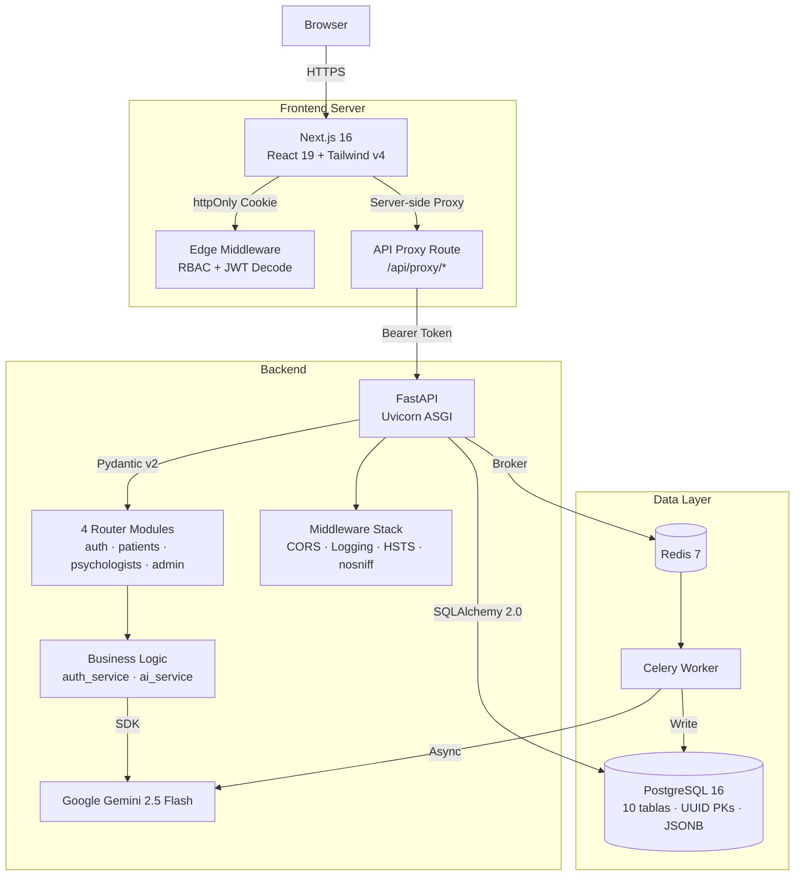
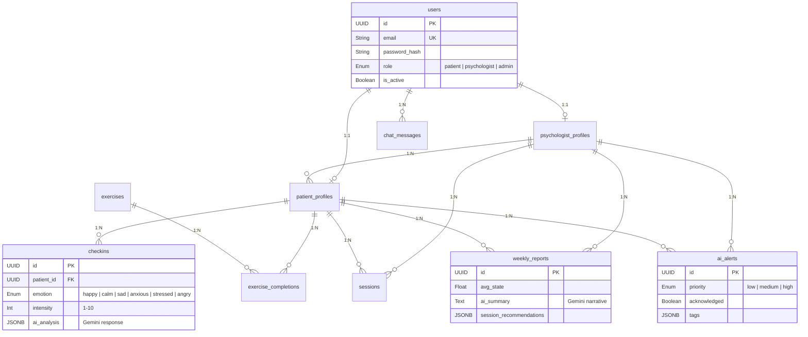

<div align="center">
  
  <h1>MindCare AI</h1>
  <strong>Plataforma HealthTech de Bienestar Emocional — Full-Stack Monorepo</strong>
  <br><br>
  <p>
    SaaS clínico que conecta pacientes con psicólogos mediante check-ins emocionales diarios,<br>
    análisis de sentimiento por <b>Google Gemini</b>, alertas de crisis automatizadas y reportes semanales generados por IA.
  </p>
</div>
<br>

<div align="center">

  [](https://nextjs.org/)
  [](https://fastapi.tiangolo.com/)
  [](https://www.postgresql.org/)
  [](https://redis.io/)
  [](https://docs.celeryq.dev/)
  [](https://www.docker.com/)
  [](https://ai.google.dev/)

</div>

---

## Tabla de Contenidos

1. [Problema y Solución](#-problema-y-solución)
2. [Arquitectura de Sistemas](#-arquitectura-de-sistemas)
3. [Modelo de Datos](#-modelo-de-datos-10-tablas)
4. [Stack Tecnológico](#-stack-tecnológico)
5. [Motor de IA (Gemini)](#-motor-de-ia--google-gemini)
6. [Portales del Sistema](#-portales-del-sistema)
7. [Mapa Completo de Endpoints](#-mapa-completo-de-endpoints-24-rutas)
8. [Quick Start (Docker)](#-quick-start-docker)
9. [Suite de Pruebas](#-suite-de-pruebas)
10. [Topología del Monorepo](#-topología-del-monorepo)
11. [Fundador](#fundador)
12. [Licencia](#-licencia)

---

## 🎯 Problema y Solución

**Problema:** Los psicólogos solo ven a sus pacientes 1 hora por semana. Los otros 167 horas no tienen visibilidad del estado emocional de sus pacientes, lo que dificulta la detección temprana de crisis y la personalización del tratamiento.

**Solución:** MindCare AI crea un puente digital continuo entre paciente y psicólogo. El paciente registra check-ins emocionales diarios que son analizados por IA en tiempo real. El psicólogo recibe un panel clínico con gráficas de evolución, alertas automáticas de crisis y reportes semanales generados por Gemini, todo sin esfuerzo manual.

---

## 🏗 Arquitectura de Sistemas

El sistema orquesta **5 contenedores** mediante Docker Compose, separando responsabilidades entre la capa de presentación, API REST, procesamiento asíncrono, persistencia y caché:



**Decisiones clave:**
- El frontend **nunca expone el JWT al browser**. La cookie es `httpOnly` + `secure` + `sameSite: lax`. El proxy server-side inyecta el Bearer Token antes de llegar al backend.
- El Edge Middleware de Next.js valida el rol del JWT **sin hacer llamadas al backend**, decodificando el payload del token para RBAC instantáneo.
- Celery procesa las tareas pesadas de IA (reportes semanales, detección de patrones de crisis) fuera del event loop de FastAPI, evitando bloqueos en la API.

---

## 💾 Modelo de Datos (10 Tablas)



**Patrones aplicados:**
- **UUIDs como Primary Keys** en lugar de auto-incrementos secuenciales, previniendo ataques de enumeración (IDOR).
- **JSONB nativo de PostgreSQL** para almacenar respuestas estructuradas de Gemini (`ai_analysis`, `tags`, `session_recommendations`) sin sacrificar la capacidad de consulta.
- **Índices B-Tree** en `checkins.patient_id` y `checkins.created_at` para consultas de telemetría eficientes.

---

## 🛠 Stack Tecnológico

| Capa | Tecnología | Decisión Arquitectónica |
| :--- | :--- | :--- |
| **Frontend** | Next.js 16, React 19, Tailwind v4, Zustand | App Router con SSR. Estado global con Zustand. Formularios con React Hook Form + Zod. Gráficas con Recharts. Animaciones con Framer Motion. |
| **Backend** | Python 3.12, FastAPI, Pydantic v2 | ASGI de alto rendimiento. Validación sub-milisegundo (Pydantic compilado en Rust). Auto-generación de OpenAPI 3.1. |
| **ORM** | SQLAlchemy 2.0 | Estilo 2.0 puro (Mapped columns). Connection pooling (`pool_size=10`, `max_overflow=20`, `pool_pre_ping=True`). |
| **Auth** | python-jose (JWT), Passlib (bcrypt) | Tokens JWT con expiración 24h. Hash bcrypt con salt automático. Factory pattern `require_role()` para RBAC. |
| **IA** | Google Gemini 2.5 Flash | 5 prompts versionados. Sanitización JSON robusta. Graceful degradation con fallback cuando la API falla. |
| **Background** | Celery 5.3 + Redis 7 | Beat scheduler: reportes semanales (domingos 23h), detección de crisis (cada 6h). |
| **Base de Datos** | PostgreSQL 16 | ACID compliance. JSONB nativo. Migraciones versionadas con Alembic. |
| **Infraestructura** | Docker Compose (5 servicios) | Paridad Dev/Prod. Health checks con `pg_isready` y `redis-cli ping`. Build multi-stage para frontend (standalone). |
| **CI/CD** | GitHub Actions | Pipeline backend (pytest + PostgreSQL service). Pipeline frontend (ESLint + build). |
| **Testing API** | Postman (29 requests) + Pytest | Suite E2E automatizada multi-rol con environment file. Tests unitarios E2E con PostgreSQL efímero. |

---

## 🧠 Motor de IA — Google Gemini

El módulo de IA opera en dos modos: **síncrono** (respuesta inmediata al check-in) y **asíncrono** (tareas programadas vía Celery).

### Prompts Versionados (`backend/app/ai/prompts.py`)

| Prompt | Trigger | Output |
| :--- | :--- | :--- |
| `EMOTION_ANALYSIS` | Paciente envía check-in | JSON: `analysis_text`, `risk_level`, `detected_patterns`, `tags`, `recommendation` |
| `CRISIS_DETECTION` | Celery Beat (cada 6h) | JSON: `alert_required`, `priority`, `description`, `contributing_factors` |
| `WEEKLY_SUMMARY` | Celery Beat (domingos 23h) | JSON: `summary`, `main_emotions`, `trend`, `session_recommendations` |
| `SESSION_RECOMMENDATIONS` | Psicólogo genera reporte | JSON: `recommendations[]` |
| `CHATBOT_SYSTEM` | Chat en tiempo real | Texto empático en español, máximo 2-3 oraciones |

### Pipeline de Procesamiento

1. Paciente envía check-in (`POST /api/patients/checkins`).
2. FastAPI guarda el registro en PostgreSQL y llama a Gemini sincrónicamente.
3. Gemini retorna JSON estructurado. El backend sanitiza la respuesta (strip markdown fences, parse JSON).
4. Si Gemini falla, el sistema retorna un fallback estático — nunca rompe el flujo del usuario.
5. En paralelo, cada 6 horas Celery analiza los últimos 5 días de check-ins buscando patrones de crisis (≥3 check-ins negativos con intensidad ≥7). Si detecta un patrón, genera una `AIAlert` y cambia el estado del paciente a `needs_attention`.

---

## 🖥 Portales del Sistema

### Portal del Paciente
- **Check-in emocional** con selector de emoción, slider de intensidad (1-10) y nota libre.
- **Chat con IA** post check-in — conversación empática contextualizada con el estado emocional actual.
- **Reconocimiento de voz** (Web Speech API) para dictar mensajes al chat.
- **Historial emocional** con timeline visual y análisis de IA por registro.
- **Ejercicios terapéuticos** (respiración, mindfulness, journaling, relajación) con tracking de completados.
- **Gestión de videoconsultas** con estado relativo (Hoy, Mañana), enlaces seguros a videollamadas y capacidad de cancelación con Optimistic UI.

### Portal del Psicólogo
- **Dashboard clínico** con KPIs en tiempo real (pacientes activos, alertas pendientes, sesiones, mejora promedio).
- **Lista de pacientes** con filtro por estado, búsqueda por nombre y cards con score emocional + indicador de tendencia.
- **Detalle por paciente** — gráfica de evolución 7 días, historial de check-ins, generación de reportes IA.
- **Alertas de crisis** con prioridad visual (roja/naranja), tags de detección y botón de acknowledge.
- **Informes semanales** generados por Gemini con descarga a **PDF profesional** (jsPDF con branding MindCare).
- **Analíticas** — Gráfica de tendencia (AreaChart), distribución de emociones (BarChart horizontal), distribución de estados (PieChart donut), ranking de pacientes por riesgo.
- **Gestión de Telemedicina Síncrona (Sesiones)** — CRUD completo de citas. Permite agendar con enlaces a videollamadas (Meet/Zoom), reagendar, cancelar y marcar como completadas.

### Portal de Administrador
- **Vista global** con métricas de plataforma (pacientes, psicólogos, check-ins procesados, modelos IA activos).
- **Health check de Gemini** — mide latencia real del modelo en tiempo real.
- **Tabla de usuarios recientes** con rol, estado y tiempo relativo de registro.
- **Gestión de usuarios** — toggle de activación/desactivación.

---

## 📡 Mapa Completo de Endpoints (24+ Rutas)

### Auth
| Método | Ruta | Descripción |
| :---: | :--- | :--- |
| POST | `/api/auth/register` | Registro con asignación automática de psicólogo (load balancing) |
| POST | `/api/auth/login` | Login con emisión de JWT (24h) |
| GET | `/api/auth/me` | Perfil del usuario autenticado |

### Patient Portal
| Método | Ruta | Descripción |
| :---: | :--- | :--- |
| GET | `/api/patients/dashboard` | KPIs: streak, estado general, ejercicios, próxima cita |
| POST | `/api/patients/checkins` | Envío de check-in + análisis Gemini síncrono |
| GET | `/api/patients/checkins` | Historial de check-ins con AI analysis |
| GET | `/api/patients/exercises` | Catálogo de ejercicios terapéuticos |
| POST | `/api/patients/exercises/{id}/complete` | Marcar ejercicio como completado |
| GET | `/api/patients/sessions` | Citas programadas del paciente (con URL de videollamada) |
| PATCH | `/api/patients/sessions/{id}/cancel` | Cancelación segura de cita (propia) |

### Psychologist Portal
| Método | Ruta | Descripción |
| :---: | :--- | :--- |
| GET | `/api/psychologists/dashboard` | KPIs clínicos agregados |
| GET | `/api/psychologists/patients` | Lista de pacientes asignados |
| GET | `/api/psychologists/patients/{id}` | Detalle completo del paciente |
| GET | `/api/psychologists/patients/{id}/checkins` | Historial clínico del paciente |
| GET | `/api/psychologists/patients/{id}/evolution` | Evolución emocional (7 días) |
| POST | `/api/psychologists/patients/{id}/generate-report` | Genera reporte semanal con Gemini |
| GET | `/api/psychologists/reports` | Lista de reportes generados |
| GET | `/api/psychologists/alerts` | Alertas de crisis activas |
| PATCH | `/api/psychologists/alerts/{id}/acknowledge` | Marcar alerta como revisada |
| GET | `/api/psychologists/sessions` | Historial y citas activas del psicólogo |
| POST | `/api/psychologists/sessions` | Programar nueva sesión con enlace de videollamada |
| PATCH | `/api/psychologists/sessions/{id}/cancel` | Cancelar cita programada |
| PATCH | `/api/psychologists/sessions/{id}/complete` | Marcar sesión como completada |
| PATCH | `/api/psychologists/sessions/{id}/reschedule` | Modificar fecha u hora de la cita |
| GET | `/api/psychologists/analytics/trend` | Tendencia diaria agregada |
| GET | `/api/psychologists/analytics/emotions` | Distribución de emociones |

### Admin Portal
| Método | Ruta | Descripción |
| :---: | :--- | :--- |
| GET | `/api/admin/dashboard` | Métricas globales de plataforma |
| PATCH | `/api/admin/users/{id}/toggle-active` | Activar/desactivar usuario |

### AI Chat & Health
| Método | Ruta | Descripción |
| :---: | :--- | :--- |
| POST | `/api/chat` | Chat REST con Gemini (gestionado vía Next.js BFF) |
| GET | `/` | Health check del servicio |
| GET | `/api/health` | Health check de la API |

---

## 🐳 Quick Start (Docker)

### Prerrequisitos
- [Docker Engine](https://docs.docker.com/engine/install/) + [Docker Compose](https://docs.docker.com/compose/install/)

### 1. Clonar y configurar variables de entorno
```bash
git clone https://github.com/HectorPalacios/mindcare-ai.git
cd mindcare-ai
cp .env.example .env       # Colocar GEMINI_API_KEY aquí
cp backend/.env.example backend/.env
```

### 2. Levantar los 5 servicios
```bash
docker-compose up -d --build
```

### 3. Seed de datos de demostración
```bash
docker-compose exec backend python seed.py
```

### 4. Acceder
| Servicio | URL |
| :--- | :--- |
| Frontend | [http://localhost:3000](http://localhost:3000) |
| API Swagger | [http://localhost:8000/docs](http://localhost:8000/docs) |
| API ReDoc | [http://localhost:8000/redoc](http://localhost:8000/redoc) |

---

## 🧪 Suite de Pruebas

### Postman — E2E Automatizado (29 requests)
La colección cubre el 100% de los endpoints con test scripts en cada request:
```
tests/postman/
├── MindCare_AI_Automated.postman_collection.json   # 29 requests, 6 folders
└── MindCare_AI_Local.postman_environment.json      # Variables dinámicas
```

**Flujo:** Health → Register → Login Patient → Patient Portal → Login Psychologist → Psychologist Portal → Login Admin → Admin Portal → AI Chat.

### Backend — Pytest
```bash
docker-compose exec backend pytest -v
```

---

## 🛡️ Estándares de Ingeniería y Calidad de Código

Este monorepo opera bajo una estricta política de **"Zero-Tolerance"** en ambos extremos del stack, asegurando código predecible y libre de fallos silenciosos:

- **Strict Type-Safety (Zero `any`):** Tipado estricto absoluto en TypeScript mediante el uso de genéricos y constructos `unknown`. En el backend, `Pydantic v2` rechaza cualquier request que no cumpla matemáticamente el contrato de datos.
- **Zero-Warning State:** El compilador del frontend (`next build`) y el linter (`eslint`) operan sin una sola advertencia (Exit code: 0). Los ciclos de vida y dependencias de hooks están matemáticamente controlados.
- **Dev/Prod Parity (Testing):** Las pruebas unitarias y E2E de Pytest se ejecutan exclusivamente contra contenedores efímeros de PostgreSQL 16, garantizando paridad absoluta con producción y previniendo colisiones de dialectos SQL.
- **Graceful Degradation:** Tipado estricto en los bloques de captura (`error: unknown`) con validación defensiva en el DOM y endpoints de fallback en FastAPI, asegurando que el sistema nunca colapse ante caídas de servicios externos (ej. Gemini).
- **OWASP Compliance:** Prevención de XSS y CSRF nativa en React 19, sanitización de Markdown y uso estricto de JWTs en cookies `httpOnly` mediadas por el Edge Middleware.

---

## 📂 Topología del Monorepo

```text
mindcare-ai/
├── frontend/                          # Next.js 16 Application
│   ├── src/app/(landing)/             # Landing page (Hero, Features, Benefits, CTA)
│   ├── src/app/login/                 # Autenticación
│   ├── src/app/register/              # Registro multi-rol
│   ├── src/app/patient/               # Dashboard + Profile del paciente
│   ├── src/app/psychologist/          # Dashboard + Detail clínico
│   ├── src/app/admin/                 # Panel administrativo + Gestión de usuarios
│   ├── src/app/api/                   # Server routes (login, logout, register, proxy, chat)
│   ├── src/components/                # Landing UI, ChatWidget, ProtectedRoute
│   ├── src/hooks/                     # useChat, useCheckin, usePatients
│   ├── src/types/                     # TypeScript contracts (144 líneas)
│   ├── src/middleware.ts              # Edge RBAC (JWT decode + role routing)
│   └── Dockerfile                     # Multi-stage standalone build
├── backend/
│   ├── app/models/                    # 10 SQLAlchemy models (UUID PKs, JSONB)
│   ├── app/routers/                   # 4 router modules (auth, patients, psychologists, admin)
│   ├── app/services/                  # auth_service (JWT + bcrypt), ai_service (Gemini SDK)
│   ├── app/ai/prompts.py             # 5 versioned prompt templates
│   ├── app/tasks/                     # Celery: analyze_patterns + generate_reports
│   ├── app/middleware/                # Request logging (Request ID + latency) + Security headers
│   ├── app/config.py                  # Pydantic BaseSettings (env-driven)
│   ├── app/database.py               # Connection pool (pool_size=10, max_overflow=20)
│   ├── alembic/                       # SQL migration history
│   ├── tests/                         # Pytest suite (PostgreSQL ephemeral)
│   ├── seed.py                        # Demo data generator (realistic patterns)
│   └── Dockerfile                     # Python slim optimized
├── tests/postman/                     # E2E collection + environment (29 requests)
├── .github/workflows/                 # CI/CD pipelines (backend + frontend)
├── docker-compose.yml                 # 5-service orchestration
└── .gitignore                         # Security-hardened exclusions
```

---

## Fundador

**Fundado y desarrollado por Hector Palacios Romero**  
*(Full-Stack & Architecture Engineer)*

[](https://www.linkedin.com/in/hectorpalaciosromero/)
[](https://github.com/hectorpalaciosromero)
[](mailto:hectorpalaciosromero1@gmail.com)

---

## 📜 Licencia

Propietario — Closed Source (Consultar archivo `LICENSE` para más detalles).

---

<div align="center">
  <i>MindCare Health — Ingeniería de Salud Mental impulsada por Inteligencia Artificial. 2025-2026.</i>
</div>
